# moss-image-edit-charref-v2: character reference LoRA for MOSS-Image

A LoRA for [MOSS-Image SFT](https://huggingface.co/OpenMOSS-Team/MOSS-Image-SFT) that takes one picture of an anime character and a text prompt, and draws that character in the scene the prompt describes. Hair, face, outfit and accessories come from the picture. Pose, framing and background come from the prompt.

This is an early version. It keeps a character recognisably in about half of plain renders, and it has known misses. Read [Limits](#limits) before relying on it.

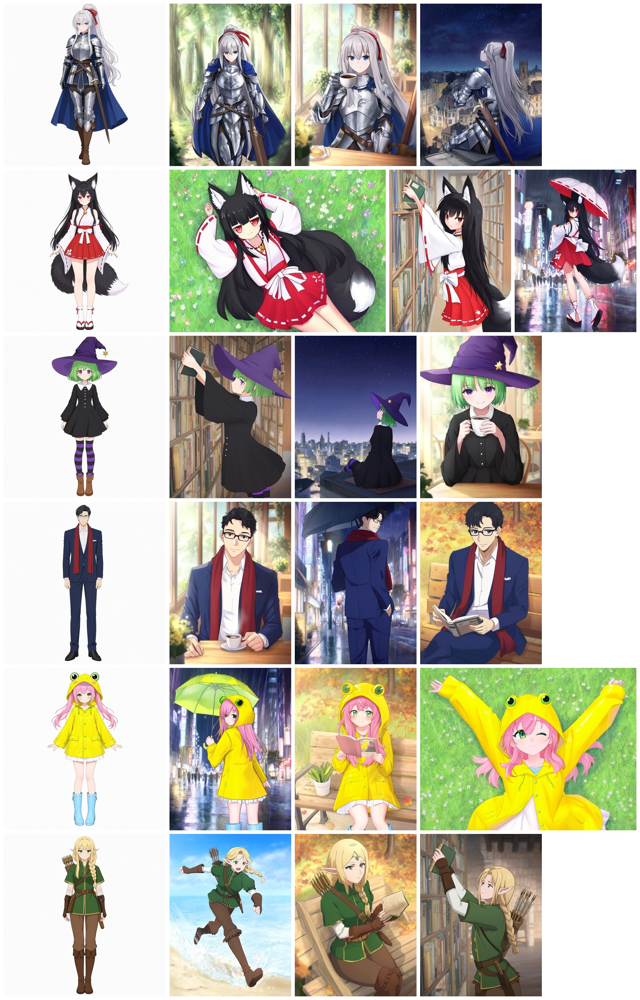

It also stacks with style LoRAs: see [With a style LoRA](#with-a-style-lora).

Each row is one character: the reference on the left, then three scenes from three different prompts. All six references were made with MOSS-Image SFT text-to-image, and every scene here uses reference guidance at seed 1. Eight characters were rendered in all; the other two are shown under [Limits](#limits).

## Use it in ComfyUI

**1. Install the node.** Copy [`custom_nodes/moss_image_charref`](custom_nodes/moss_image_charref) into `ComfyUI/custom_nodes/` and restart ComfyUI. It needs no extra packages. Update ComfyUI to a current version that includes the **Text Encode MOSS-Image Edit** node.

The node is required. ComfyUI normally places a reference picture on the same positions as the output, and this LoRA was trained with the reference placed below the output instead. Without the node the LoRA does not work as tested.

**2. Download the models** into your ComfyUI `models` folder:

| File | Folder | Size |
|---|---|---|
| [moss_image_sft_bf16.safetensors](https://huggingface.co/Comfy-Org/MOSS-Image/resolve/main/diffusion_models/moss_image_sft_bf16.safetensors) | `diffusion_models/` | 10.2 GB |
| [qwen3.5_9b_bf16.safetensors](https://huggingface.co/Comfy-Org/MOSS-Image/resolve/main/text_encoders/qwen3.5_9b_bf16.safetensors) | `text_encoders/` | 19.3 GB |
| [flux2-vae.safetensors](https://huggingface.co/Comfy-Org/MOSS-Image/resolve/main/vae/flux2-vae.safetensors) | `vae/` | 336 MB |
| [moss_image_edit_charref_v2.safetensors](../../releases/latest) | `loras/` | 297 MB |

SHA-256 of `moss_image_edit_charref_v2.safetensors`: `4e0b874ccc4e5f177fee38fbcc975493f13a962b9c8a791f16448115fd5f9369`

**3. Drag a workflow into ComfyUI:**

| Workflow | Use it when |
|---|---|
| [`moss_charref_reference_guidance.json`](workflows/moss_charref_reference_guidance.json) | You want the closest likeness. It runs one extra pass without the reference, so each image takes about 1.4 times as long. The examples above use it. |
| [`moss_charref.json`](workflows/moss_charref.json) | You want the faster, plain sampling. It follows the prompt a little more often and keeps the character a little less often. |
| [`moss_charref_turbo_style.json`](workflows/moss_charref_turbo_style.json) | You want MOSS-Image SFT Turbo at 8 steps, with a slot for a style LoRA. It needs [`moss_image_sft_turbo_int8_convrot.safetensors`](https://huggingface.co/toxicdog/MOSS-Image-SFT-Turbo-INT8-ConvRot) in `diffusion_models/` and [`qwen3.5_9b_int8_convrot.safetensors`](https://huggingface.co/Comfy-Org/MOSS-Image/resolve/main/text_encoders/qwen3.5_9b_int8_convrot.safetensors) in `text_encoders/`. |

To try the example, copy [`example_reference.png`](workflows/example_reference.png) into ComfyUI's `input` folder. API-format versions for scripts are in [`workflows/api/`](workflows/api/).

**4. Pick your character in Load Image, write the prompt, and queue.** On an RTX 5090 one image took about 19 s plain and 26 s with reference guidance. Smaller cards and the quantized model files were not tested.

### The reference picture

- One character on a plain white background, in a neutral pose with the arms down. A pose with the hands up can be copied into the output next to the pose you asked for.
- A full-body picture keeps the whole outfit. A picture cropped from head to thighs keeps the face, eye colour and ears better.
- The workflow fits it into a 448 px white square for you.
- A clean, flat-shaded picture gives the cleanest results. See [Limits](#limits) for painterly references.

A quick way to get a reference is MOSS-Image SFT itself: describe the character and end the prompt with `Full body, standing, facing the viewer, plain white background.` That is how every reference on this page was made.

### The prompt

Write the scene, pose and framing as comma-separated tags, starting with `1girl, solo` or `1boy, solo`. For example:

```
1girl, solo, sitting, cafe, table, holding cup, coffee, window, sunlight, smile, looking at viewer, upper body
```

Leave the character's looks out of the prompt. They come from the picture.

### Settings to keep

The results below were measured with these settings, and the workflows already use them:

| Setting | Value |
|---|---|
| Edit format | `ai-toolkit` |
| Negative | Empty prompt, with the same reference attached |
| LoRA strength | 1.0 |
| Sampling | 50 steps, CFG 3, `euler`, `sgm_uniform`, denoise 1.0 |
| Skip-layer guidance | Block 22 (`single_layers` = 22). In the reference guidance workflow it is inside the guider node. |
| Reference guidance | 2.5 in the guided workflow |
| Size | About 0.6 megapixels, for example 672 x 896, sides in multiples of 16 |

## With a style LoRA

This LoRA carries the character and has no strong look of its own, so the look can come from a style LoRA. Load the style LoRA right after this one, before the Reference layout node, at 0.6 to 0.8, and put its trigger word, if it has one, at the start of the prompt. [`moss_charref_turbo_style.json`](workflows/moss_charref_turbo_style.json) has the slot ready.

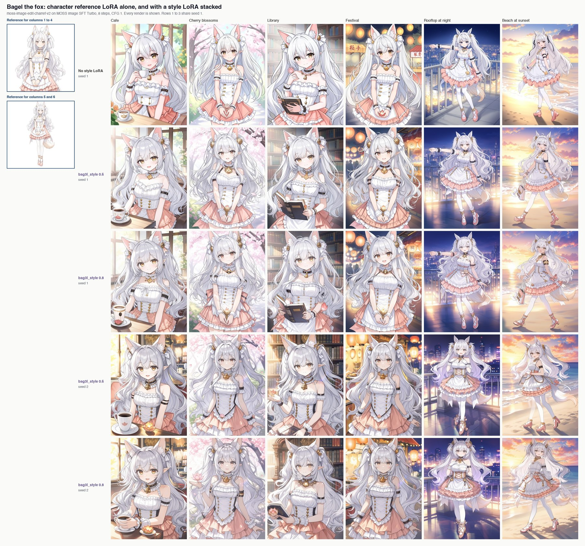

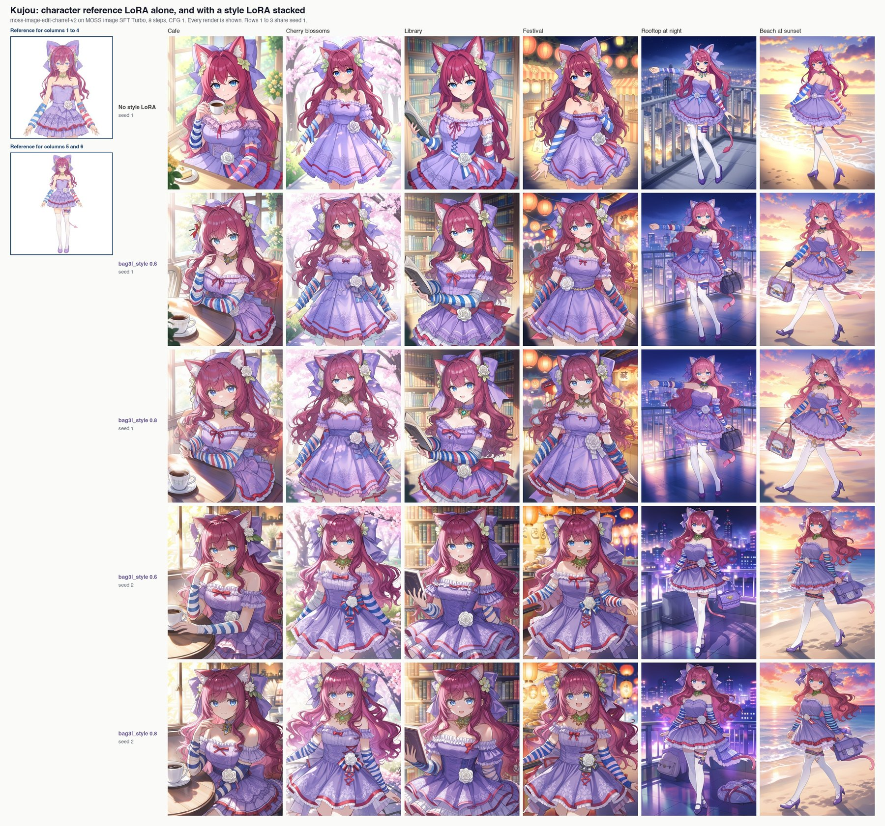

Each sheet has the two references on the left and six scenes across. The first row is this LoRA alone; the rows below add one style LoRA at 0.6 and at 0.8, on two seeds. Every render is shown.

- An automatic same-character check passed 48 of the 48 styled pictures, and 11 of the 12 without a style. That is two characters with one reference each: a first check, not a benchmark.
- At 0.8 the look is stronger and the character drifts a little more.
- Check the hands, and watch for extra props: with the style on, a few full-body pictures gained a handbag that is in neither the reference nor the prompt.
- These sheets were rendered with MOSS-Image SFT Turbo: 8 steps, CFG 1, `euler`, `simple`. On Turbo keep reference guidance off or at 1.5 at most; at 2.5 it copies the reference's pose. The style LoRA in them, `bag3l_style`, is not publicly available. It is the only style LoRA tested here; others may behave differently.

## Results

Tested on 24 anime characters that were not in training, each with a prompt for a new pose and scene, on three seeds: 72 images per row.

| Sampling | Same character kept | Pose and scene follow the prompt |
|---|---|---|
| Plain | 50% | 85% |
| Reference guidance 2.5 | 61% | 78% |

- "Same character kept" is an automatic same-character check (CCIP) between the output and the reference. It is strict: an image can look right to a person and still fail it, and the reverse.
- Across the three seeds the first column ranged from 46% to 54% plain and from 58% to 62% with reference guidance.
- The packaged workflows were checked against these test renders: the same reference, prompt and seed gave the same image, pixel for pixel.

## Limits

- **Details get lost.** Skin tone, eye details and small accessories are the first to go. In the two characters below, the boy's tan skin came out pale and his golden eyes turned into tinted glasses, and the maid's eyepatch became hair over the eye or a yellow lens.

  | Reference | Scene 1 | Scene 2 | Scene 3 |
  |---|---|---|---|
  | 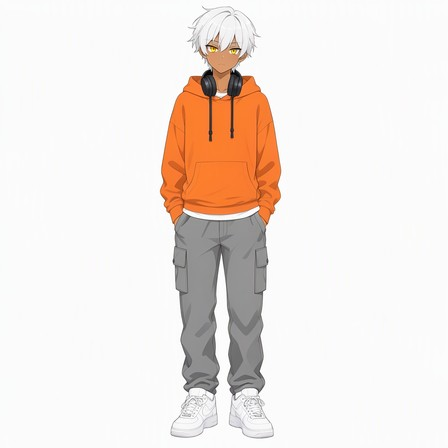 | 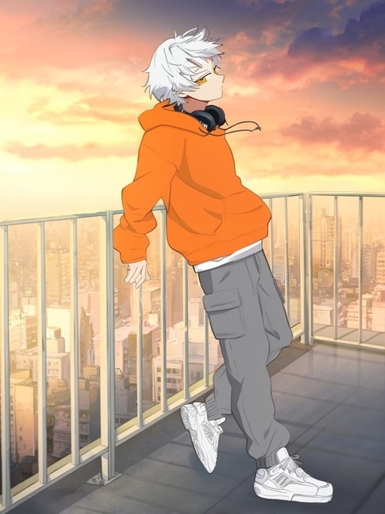 | 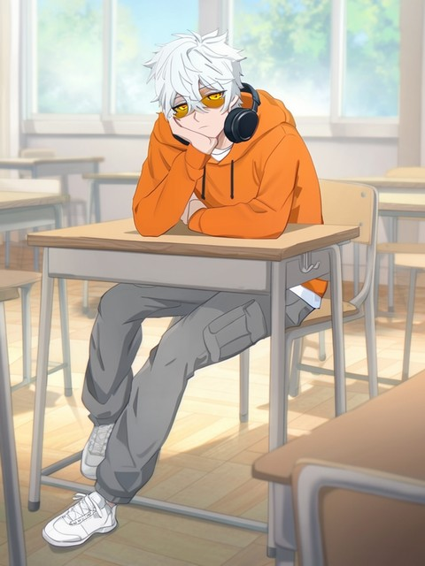 | 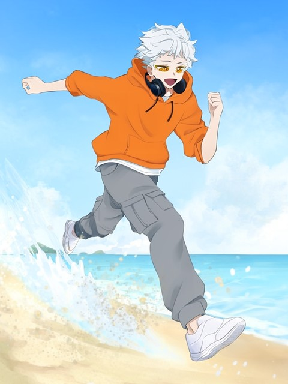 |
  | 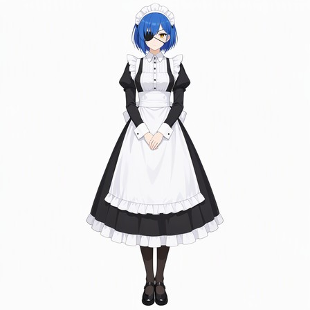 | 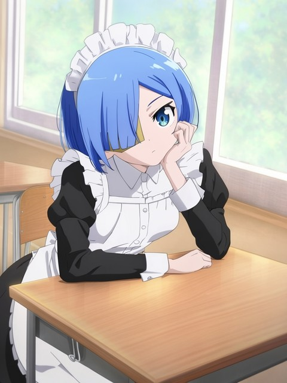 | 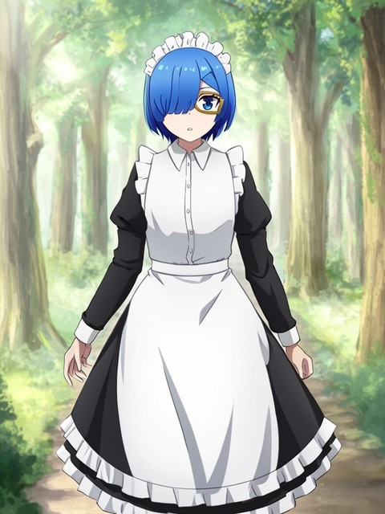 | 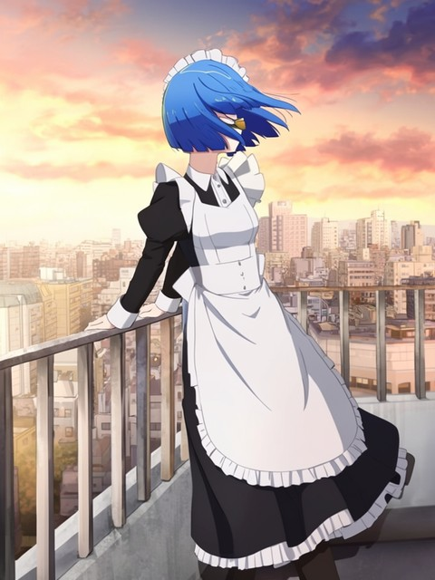 |

- **It copies the reference's rendering.** A painterly or effect-heavy reference pulls its brushwork, colour cast and effects into the output, which can come out muddy. A reference sheet with two figures can give two figures. Use a clean single figure.
- **About half of plain renders pass the same-character check.** Try another seed, or use the reference guidance workflow.
- **Things can be added.** The elf above gained a forehead gem in one scene.
- **The reference's pose can leak.** A reference with raised hands can give a picture with four hands: the reference's and the prompt's. A negative prompt did not fix it in our test. Use a neutral reference.
- **Not tested:** the MOSS-Image Base model, more than one style LoRA, sizes above about 0.6 megapixels, more than one reference picture, photos, and other LoRA strengths or samplers. MOSS-Image SFT Turbo and the style LoRA stack were checked by eye and with the small check above, not with the test under Results.
- **One training run.** The numbers come from a single run of this LoRA.

Outputs are AI-generated, so please label them that way.

## Training

Trained with [ai-toolkit](https://github.com/ostris/ai-toolkit) on MOSS-Image SFT: 5,000 steps, rank 64, learning rate 1e-4, batch size 4, 512 px. One step in five was a regularization step.

## License

The LoRA, the node and the workflows are released under the [MIT License](LICENSE). The license covers this release only, and makes no statement about rights in the training data.
